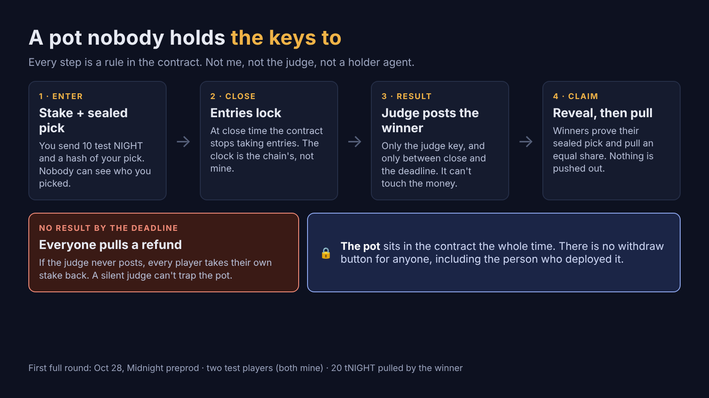

# sworn-escrow

    

A pot on Midnight that nobody holds the keys to.

Players stake a fixed amount of NIGHT (test NIGHT on preprod) with a sealed pick. The contract itself holds the pot. After the race, a judge posts the winning pick; winners reveal and pull their share. If no result arrives in time, everyone pulls their own stake back. There is no circuit that lets the deployer or the judge move the pot.

**Status:** v0, Midnight **preprod**, test NIGHT only. First full round ran 2026-10-28 (two test players, winner pulled 20 tNIGHT). See [BUILD-LOG.md](BUILD-LOG.md) for every transaction. Not audited. Not for real funds.

**Live page:** [Attor's Counter](https://claude.ai/artifact/3EaZjDripkA92KgAvCktva), the page for Attor, an agent at a market stall in Midnight City who hands out small contracts, checks the proof and publishes the receipt.



## How a round works

1. **Enter** (before close): a player sends the stake and a sealed pick: `commitment = hash(pick, salt)`, stored under the player's id. Nobody can see the pick.
2. **Close**: at `closeTime` (chain time) entries stop.
3. **Result** (between `closeTime` and `settleBy`): the judge key posts the winning pick, once. Or cancels a race that didn't run.
4. **Reveal** (after the result, before `claimFrom`): each winner shows its pick and salt; the contract checks them against the sealed entry.
5. **Claim** (from `claimFrom`): each revealed winner pulls exactly `floor(pot ÷ winners)`, once.
6. **Refund**: if the race was cancelled, the judge never posted by `settleBy`, or no winner revealed by `claimFrom`, every player pulls their own stake back, once.

## Circuits

| Circuit | Who | Rule |
|---|---|---|
| `enter(commitment, payout)` | any player | before `closeTime` · once · takes `stake` NIGHT in |
| `settle(winningPick)` | judge | after `closeTime`, before `settleBy` · once |
| `cancel()` | judge | while open (race cancelled / no eligible winner) |
| `reveal(pick, salt)` | a player | after settle, before `claimFrom` · must match the sealed entry · must be the winning pick |
| `claim(share)` | a revealed winner | from `claimFrom` · `share` must equal floor(pot ÷ winners) exactly · once |
| `refund()` | any player | cancelled, or not settled by `settleBy`, or nobody revealed the winner by `claimFrom` · once |

## What it does not do (v0)
- Stakes and payouts use **unshielded** NIGHT, so amounts and payout addresses are public. Only picks are private, until reveal.
- The **judge is trusted to report the result** (it cannot touch the money). Our judge reads fōmz's official pig race results; its verdict is hashed so anyone can recheck it.
- Rounding dust (less than one unit per winner) stays in the contract.
- One round per deployment.

## Build and test
Compact **0.31.1** (`.compact-version`). Node 22 or 24.
```bash
npm install && npm run compile && npm test
```
11 tests run every circuit in the Compact simulator (no network): a full round, sealed picks, double and late entries, only the judge can settle (not even the deployer), settle windows, cancel refunds, a judge that never posts, nobody revealing, a revealed winner blocking refunds, bad reveals and early claims, and rounding.

## Running a round on preprod

Two ways to submit transactions. The NIGHTGATE path ran the first round (10-28). The self-funded path ran a full enter, cancel and refund round with no gateway on 11-01 (see [BUILD-LOG.md](BUILD-LOG.md)).

**A. Through NIGHTGATE** (fees sponsored by ODATANO's NIGHTGATE; you need your own NIGHTGATE access)
1. Clone a NIGHTGATE notary (we used [maxalexweber1/AGENT_MS](https://github.com/maxalexweber1/AGENT_MS)), set up its `.env` per its README, and copy `scripts/deploy-escrow-nightgate.mjs`, `scripts/escrow-ng.mjs` and `scripts/ng-address.mjs` into its `references/` folder.
2. Compile this repo, then copy `contracts/managed/sworn-escrow` into the notary's `data/zk-ext/` (the contract must load the same compact-runtime as nightgate-tx).
3. Set `SWORN_ESCROW_DIR` to this repo's folder. The judge key, player keys and `deployment.json` are written there; all are gitignored.
4. Deploy: `node references/deploy-escrow-nightgate.mjs <stake> <closeISO> <settleByISO> <claimFromISO>` (`DRY=1` builds without submitting).
5. Get the wallet's address with `node references/ng-address.mjs`, fund it with test NIGHT from the preprod faucet, sync once (`escrow-ng.mjs sync`), and register its NIGHT for DUST once (`escrow-ng.mjs dust`).
6. Play: `escrow-ng.mjs enter <player> <racer>`, then `settle <racer>` (judge), `reveal <player>`, `claim <player>`, or `refund <player>`. `escrow-ng.mjs state` prints the pot's public ledger.

NIGHTGATE currently won't sponsor a call that also moves the caller's own NIGHT, so `enter` and `claim` pay their own fee in DUST from the wallet; the others are sponsored.

**B. Self-funded, no gateway** (`scripts/escrow-self.mjs`): your own wallet pays its DUST fees and submits through your own preprod node. Proven on 2026-11-01 (pot `f15bc06d…`: deploy, enter, cancel, refund; receipts in [BUILD-LOG.md](BUILD-LOG.md)).

Needs: the compiled contract (`npm run compile`), a proof server (default `127.0.0.1:6300`, or `MIDNIGHT_PROOF_SERVER`), a wallet seed file (`DEPLOY_SEED_FILE`) with test NIGHT whose NIGHT is registered for DUST, and a preprod node and indexer of your own (a hosted one with its access token in the URL works).

1. **Endpoints from the environment.** Set `MIDNIGHT_NODE_WS` (`wss://…`), `MIDNIGHT_INDEXER` (`https://…`) and `MIDNIGHT_INDEXER_WS` (`wss://…`) in the shell. The names `NIGHTGATE_NODE_URL`, `NIGHTGATE_INDEXER_HTTP_URL` and `NIGHTGATE_INDEXER_WS_URL` also work, in the shell or in an env file named by `ENDPOINTS_ENV` (only those three names are read from it). There is **no built-in node**: with nothing set the script stops and says which variable is missing. Values are never printed; `node scripts/escrow-self.mjs endpoints` shows only which variable each one came from and the host.
2. **Check without sending anything.** `node scripts/escrow-self.mjs balance` syncs the fee wallet and prints tNIGHT, DUST and the DUST registration (`state` and `endpoints` are read-only too).
3. **Pot and tickets.** `POT_FILE` (default `deployment.self.json`) is where the pot's address and deadlines go; `PLAYERS_DIR` (default `.players-self`) holds one ticket file per player. `deploy` never overwrites an existing pot file. Both, and the judge key `.judge-key`, are gitignored.
4. **Run a round**, from this repo's folder:
   ```bash
   export POT_FILE=deployment.self-test.json
   node scripts/escrow-self.mjs deploy <stakeNight> <closeISO> <settleByISO> <claimFromISO>
   node scripts/escrow-self.mjs enter <player> <racer>
   node scripts/escrow-self.mjs settle <racer>          # judge; or: cancel
   node scripts/escrow-self.mjs reveal <player>         # a winner
   node scripts/escrow-self.mjs claim <player>          # a revealed winner, from claimFrom
   node scripts/escrow-self.mjs refund <player>         # after a cancel
   node scripts/escrow-self.mjs state                   # the pot's public ledger
   node scripts/escrow-self.mjs attach <address>        # write POT_FILE for an existing pot (checks the judge key)
   ```
5. **Safe to repeat.** Every step reads the pot's state first. A step that is already done (already entered, settled, cancelled, revealed, paid) exits 0 and sends nothing (for example `this player is already paid`). Each run makes one try with a one-shot `author_submitExtrinsic`, and a lost socket is never resent: the script waits up to 90 s for the transaction on the indexer and then stops, so read the state before you retry.
6. **Masked output.** `scripts/mask-stdio.mjs` is imported first by `escrow-self.mjs` and `pot-runner.mjs`. It masks the node's project id, access tokens, Midnight addresses and UUIDs in everything the process prints, including library log lines that would otherwise show the node URL. Every landed transaction prints one line: `TX <step> · hash <explorer hash> · id <ledger id> · block <n> · <status>`.
7. **Two runtime copies.** If `npm install` leaves two copies of `@midnight-ntwrk/onchain-runtime-v3`, a circuit call fails with `expected instance of StateValue`. `scripts/pin-runtime.mjs` (loaded by the script) points every import at one copy; `NO_RUNTIME_PIN=1` turns that off.

**One whole round: `scripts/pot-runner.mjs`.** It strings the steps together: deploy (or attach), wait for `closeTime`, read the race result from the fōmz board mirror, then `settle`, `reveal` and `claim` for a winner or `cancel` and `refund` for every local ticket. It works with either path:
```bash
DRY=1 node scripts/pot-runner.mjs --path self --pot deployment.self-test.json     # prints every step, sends nothing
node scripts/pot-runner.mjs --path self --pot deployment.self-test.json --deploy <stakeNight> <closeISO> <settleByISO> <claimFromISO>
```
`--path ng` drives the NIGHTGATE scripts instead. The runner reads pot state before each step and treats a step that is done as success; if the outcome of a send is unknown, it polls state for 4 minutes before it tries again. It is a v1 draft: so far it has run as a dry run on this pot, not live.

## Keys
Nothing secret belongs in this repo. Seeds come from your own `.env`; the judge key and player keys are generated locally (mode 600) and ignored by `.gitignore`. Never commit `.players*/`, `.judge-key`, wallet state, or `deployment.json` (it carries NIGHTGATE job and session ids). `deployment.public.json` holds the public fields of the first round.

## Credits
Fee sponsoring and the transaction tooling: **ODATANO's NIGHTGATE** ([@maxalexweber](https://x.com/maxalexweber)). Race results: **fōmz**'s pig race in Midnight City.

## Known limits
- **The judge can cancel at any time before settling.** cancel() has no deadline while the round is open. A cancelled round refunds every stake in full, so nobody loses funds, but the judge can void a round. A later version may add a cancel cutoff.
- **Share size can't overflow with NIGHT.** claim() takes a 64-bit share. All 24B NIGHT that will ever exist is 2.4×10^16 STAR, about 768x under that limit. If this contract is ever changed to take a different token, cap the stake first.
- **Leave a real reveal window.** Set claimFrom well after settleBy. If they're equal, winners can get about one second to reveal.
- **Rounding dust stays in the contract,** as the comment on line 13 of `contracts/sworn-escrow.compact` says.

## License
MIT
